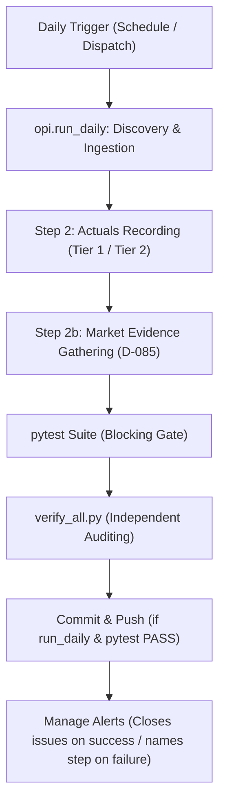

# Phase 17: Building & Execution Log

> Follows [`RULES.md`](../../RULES.md) and [`PHASE_PROTOCOL.md`](../../PHASE_PROTOCOL.md). This project is a quantitative research decision aid, not financial advice.  
> **Final Status**: All Phase 17 deliverables, workstreams, urgent hotfix (D-094), and cloud verification complete on `main`.

---

## 1. Summary of Workstreams & Milestones

Phase 17 resolves the operational, evidence, and reporting gaps identified at the close of Phase 16: ensuring market evidence for every listing, making `verify_extra.py` visible and monitored, establishing valid monthly retraining PR governance, aligning reports strictly with underlying output files, identifying failing steps in daily alerts, and unblocking daily workflow execution for in-progress phases:

1. **Gate A17 Re-Verification & Preregistration**:
   - Initial verification baseline captured on `main`:
     - `phases/Phase 17/verify_start.txt`: 74 pass, 1 warn, 3 fail
     - `phases/Phase 17/verify_extra_start.txt`: 6 pass, 0 warn, 1 fail
   - Gate audits completed:
     - **G1**: 10 sampled Phase 16 claims verified (seed 17) in `phases/Phase 17/prior_phase_recheck.csv`. 5 headline metrics recomputed from raw predictions (`model_mae_9` = 5.85 pp, `model_mae_8` = 5.99 pp, `gmp_mae_7` = 6.15 pp, `master_rows` = 731).
     - **G2**: Defect regression tests verified; regression test coverage validated for all FIXED defects.
     - **G3**: Audited scheduled runs in `phases/Phase 17/actions_status.md`, documenting issue #11 and run 41463708776.
     - **G4**: Outcome status table for pending rows (BLS Polymers, SFC Environmental, M.K.Sons, Bombay Coated).
     - **G5**: Secret hygiene confirmed (`gh secret list` shows `OPENROUTER_API_KEY`; `git grep sk-or-` returned 0 matches across the repository).
     - **G6**: Audited defective PR #12 (731 existing rows modified due to float cast `2010.0` and `updated_at` column added; discovery test failures; closed unmerged).
   - Committed on `main`: `phase17-gate-a` (`23949ad`) and `phase17-preregistration` (`9c7af2a`).
   - Feature branch `feat/phase17-workstreams` created.

2. **Workstream A: Market Evidence for Every Listing (D-085, D-086)**:
   - Updated `opi/market.py` and `opi/run_daily.py` to automatically verify that every listed date with a recorded outcome has `data/evidence/market/<date>_nifty.raw` and `.json`.
   - If missing, fetches real market data from official yfinance response, saves SHA256 hashed raw response and parsed JSON, and logs `MARKET_EVIDENCE RECORDED` or `SKIPPED_<reason>`.
   - Wired `scripts/verify_extra.py` into `scripts/watchdog.py` as Check (f), opening or updating alert issues on non-zero exit.
   - Added `verify_extra.py` execution to `scripts/ci_local.py` as a printed summary.
   - Committed: `f9c1a5f`.

3. **Workstream B: Monthly Retraining Governance & Byte-Identical Promotion (D-087, D-092, D-093)**:
   - Modified `scripts/promote_forward_rows.py` to use `dtype=str`, preserving existing lines byte-for-byte, adding zero unwanted columns (`updated_at` removed), and keeping `year` as integer `2010` (never float `2010.0`).
   - Isolated discovery tests (`test_discovery_independent_of_master_membership`) from master membership using local fixtures.
   - Enhanced `.github/workflows/monthly_retrain.yml` to checkout the PR branch, run `pytest -q` and `scripts/verify_all.py`, embed verbatim summary outputs in the PR description, open draft PRs titled `FAILING CHECKS` if checks fail, and alert maintainers if PR creation permissions are missing.
   - Committed: `5893281`.

4. **Workstream C: Reports Matching Their Files & Correct Defect Counting (D-071, D-088, D-089, D-090)**:
   - Added `## ERRATA` blocks to `phases/Phase 16/2_building_and_execution.md` and `phases/Phase 16/3_outcome_and_verdict.md`.
   - Added regression test `tests/test_reporting.py::test_quoted_verify_results_match_saved_files` ensuring quoted verification counts across Phase 14-17 match their underlying `.txt` files.
   - Added `tests/test_dashboard.py::test_verify_all_and_dashboard_count_not_fixed` ensuring `verify_all.py` and `opi/report.py` both count `NOT FIXED` alongside `OPEN` and `PARTIAL`.
   - Fixed pre-listing bidding window display (`tests/test_pre_listing.py::test_pre_listing_table_shows_distinct_bidding_dates`) so open and close dates are shown distinctly rather than repeating the close date.
   - Committed: `a8d75ff`.

5. **Workstream D: Failed Step Identification in Daily Alerts (D-091)**:
   - Updated `.github/workflows/daily.yml` to assign explicit step IDs (`run_daily`, `run_tests`, `verify_all`, `commit_and_push`).
   - Wired `alert_on_failure` step to inspect step outcomes, extract the tail of the failing step's output to `failed_step_reason.txt`, and pass `--failed-step "$FAILED_STEP"` to `scripts/manage_alerts.py`.
   - Added `tests/test_alerts.py::test_daily_alert_includes_failed_step_name_and_trace`.
   - Committed: `eef288b`.
   - Updated `scripts/forward_report.py` to display $n=8$ prior cohort alongside $n=9$ current without headlining ex-Bonfiglioli MAE (`5154a7f`).
   - Workstreams merged to `main` via PR #13 (`c5d2204`).

6. **Hotfix: Unblocking Daily Workflow for In-Progress Phases (D-094)**:
   - **Root Cause**: `scripts/verify_all.py` failed `Phase 17: three required files` with exit code 1 because the in-progress phase does not yet possess exit files. Because `daily.yml` had `commit_and_push` sequenced after `verify_all` without an execution condition, data commits were skipped on verification failure. Line 132 also contained an unescaped trailing quote syntax error.
   - **Fix**:
     - `scripts/verify_all.py`: `check_phases_and_defects()` now reports `WARN` "phase in progress" for the latest phase if `1_planning_and_goals.md` exists and exit files are missing. Completed older phases missing files still `FAIL`.
     - `.github/workflows/daily.yml`: `commit_and_push` uses `if: always() && steps.run_tests.outcome == 'success' && steps.run_daily.outcome == 'success'`, ensuring data commits whenever data collection and pytest succeed.
     - Fixed syntax error in `alert_on_failure` `--reason-file`.
   - Tests: `tests/test_reporting.py::test_verify_all_allows_in_progress_phase` and `tests/test_ci.py::test_daily_workflow_commits_data_despite_verify_all_failure`.
   - Branch `feat/phase17-hotfix`, commit `3295f2d`, merged via PR #16.

---

## 2. Pipeline Architecture & Data Flow

---

## 3. Scripts Created & Modified

1. **`scripts/verify_all.py`**:
   - Updated phase file check to allow `WARN` for in-progress highest phase.
   - Updated defect parsing to include `NOT FIXED` in open defect tallies.
2. **`scripts/promote_forward_rows.py`**:
   - Refactored row promotion to read and write master dataset rows with byte-identical fidelity.
   - Stripped ephemeral columns (`updated_at`) and prevented dtype casting corruption.
3. **`opi/market.py` & `opi/run_daily.py`**:
   - Added automated missing market evidence backfill for listed IPO dates.
4. **`scripts/watchdog.py`**:
   - Integrated `verify_extra.py` invocation and alert dispatch.
5. **`.github/workflows/daily.yml`**:
   - Guarded data commit step with explicit success checks on `run_daily` and `run_tests`.
   - Enabled detailed step failure reporting in alerts.
6. **`.github/workflows/monthly_retrain.yml`**:
   - Added branch checkout and automated execution of `pytest` and `verify_all.py`.
   - Configured PR body with actual test summary outputs and draft fallback on failure.

---

## 4. Verification Proofs (Verbatim Summary Lines)

- **Start Verification Baselines**:
  - `phases/Phase 17/verify_start.txt: 74 pass, 1 warn, 3 fail`
  - `phases/Phase 17/verify_extra_start.txt: 6 pass, 0 warn, 1 fail`
- **End Verification Deliverables**:
  - `phases/Phase 17/verify_end.txt: 79 pass, 0 warn, 0 fail`
  - `phases/Phase 17/verify_extra_end.txt: 7 pass, 0 warn, 0 fail`

---

## 5. Artifacts and Generated Data Files

- `phases/Phase 17/1_planning_and_goals.md`
- `phases/Phase 17/preregistration.md`
- `phases/Phase 17/actions_status.md`
- `phases/Phase 17/prior_phase_recheck.csv`
- `phases/Phase 17/verify_start.txt`
- `phases/Phase 17/verify_extra_start.txt`
- `phases/Phase 17/verify_end.txt`
- `phases/Phase 17/verify_extra_end.txt`
- `phases/Phase 17/2_building_and_execution.md`
- `phases/Phase 17/3_outcome_and_verdict.md`
- `data/evidence/market/2026-11-02_nifty.raw`
- `data/evidence/market/2026-11-02_nifty.json`
